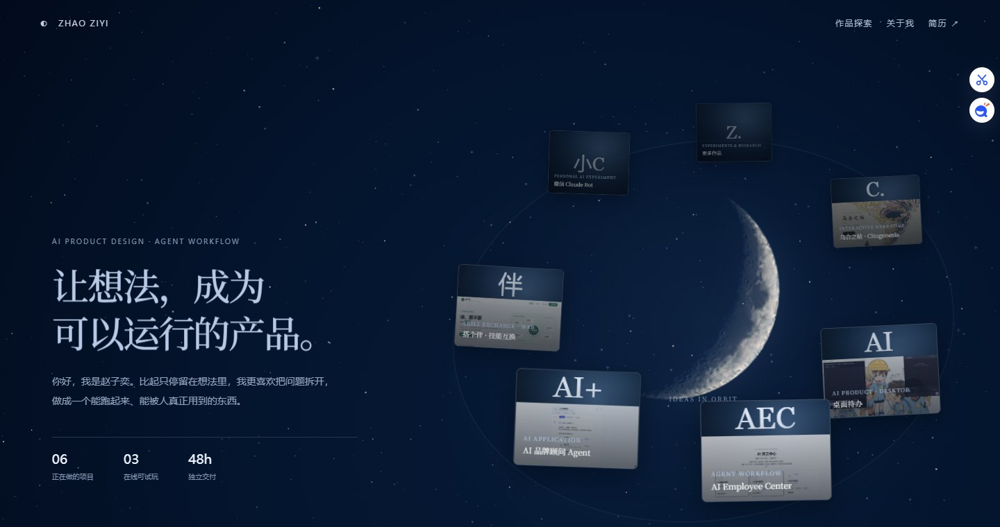

# Ziyi Zhao · 赵子奕
产品策划 / 游戏策划 / 用户研究
Product & Game Design · User Research · AI Applications

I design systems around rules, choices, and feedback — from AI workflows to game experiences.
我关注规则、选择与反馈如何塑造体验：从 AI 工作流到游戏机制。

[Portfolio](https://zzz-qwq.github.io/) · [Email](mailto:zhaoziyi1024@foxmail.com)

## 工作流与决策边界 / Workflow & Decision Design

**AI Employee Center** · AI 产品
岗位化 AI 同事：3 个岗位；7 步增长工作流中，信心不足时决策按钮直接禁用，必须先补依据才能继续。
*Role-based AI colleagues: 3 roles; in the 7-step workflow, decisions are gated until evidence is added.*
[Live](https://zzz-qwq.github.io/ai-employee-center/) · [PRD](https://zzz-qwq.github.io/aec-prd.pdf)

**Desktop Todo / 桌面待办** · 桌面工具
AI 出草稿、人工确认才写入；没有 API Key 也能用——把 AI 与人的职责边界写进流程。
*AI drafts, you confirm — the human/AI boundary is built into the flow; works without an API key.*
[Repo](https://github.com/Zzz-qwq/desktop-todo)

## 匹配机制与互动体验 / Mechanics & Interactive Systems

**搭个伴 · 技能互换** · 产品原型
双向匹配：发起邀请前必须写出互补理由；14 个节点串起从发布需求到完成交换的闭环。
*Two-way matching: no invitation without a stated reason; a 14-node loop from need to completed exchange.*
[Open](https://zzz-qwq.github.io/dagoban-skill-exchange/)

**乌合之帖 · Citogenesis** · 互动叙事游戏
48 小时九幕互动叙事；用信息关系和非惩罚性选择设计体验——选错不惩罚，只让你看见一句话如何被信成事实。
*A nine-act narrative built in 48 hours; non-punitive choices let you watch a sentence become "fact".*
[Play](https://zzz-qwq.github.io/citogenesis/) · [Video](https://zzz-qwq.github.io/citogenesis-promo.mp4)

## 玩家体验分析 / Player Experience Analysis

**开心消消乐 / 假日乐消消** · 游戏体验拆解
按「设计机制 → 玩家行为 → 体验结果 → 判断与改进」的链路做 5 页分析：步数约束、连锁反馈、提示时机、资源反馈，并给出可验证的改进方向。
*A 5-page teardown following mechanics → player behavior → experience → improvement: move limits, chain feedback, hint timing, resource feedback.*
[PDF](https://zzz-qwq.github.io/game-ux-analysis.pdf)

## Feedback

有建议、发现 bug，或者觉得哪个作品还能更好？[开一个 issue](https://github.com/Zzz-qwq/Zzz-qwq/issues/new) 或发邮件到 [zhaoziyi1024@foxmail.com](mailto:zhaoziyi1024@foxmail.com)。  
*Ideas, bugs, or feedback? Open an issue or email me.*
